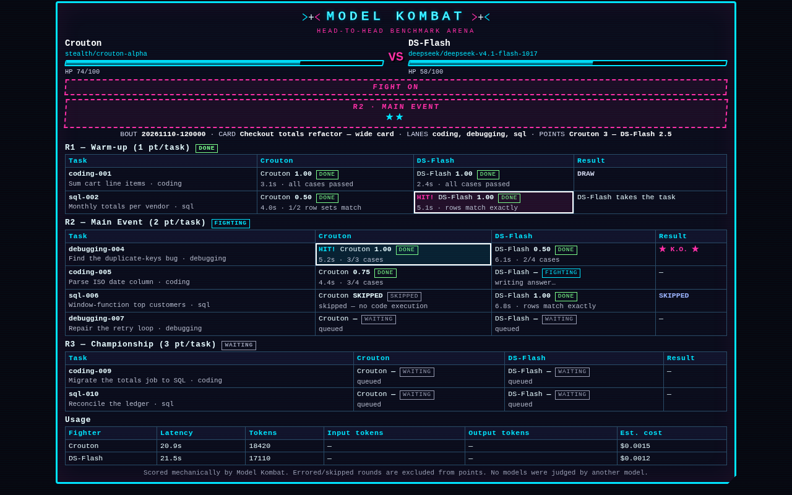
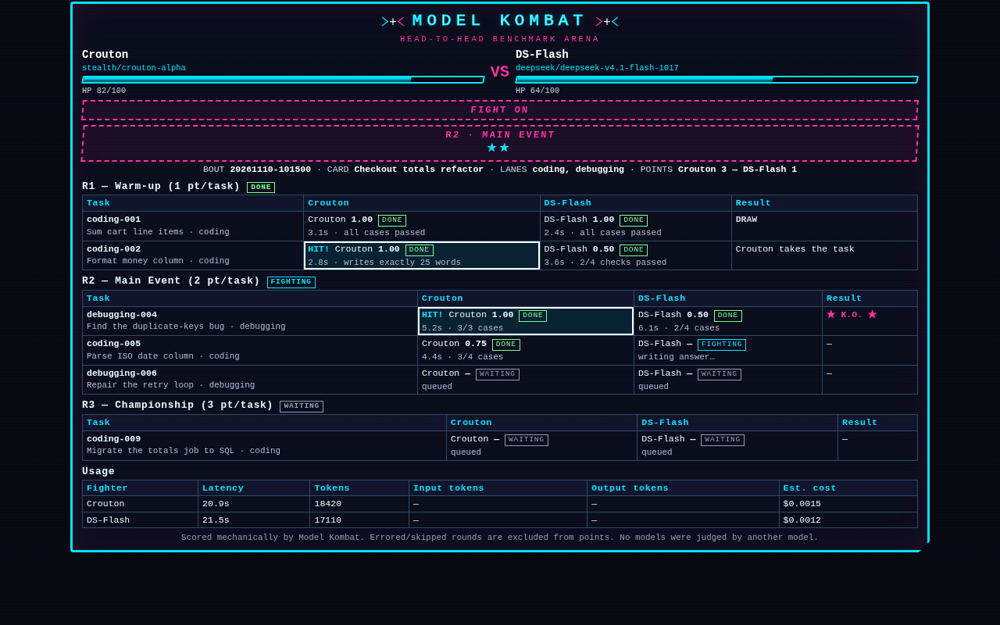
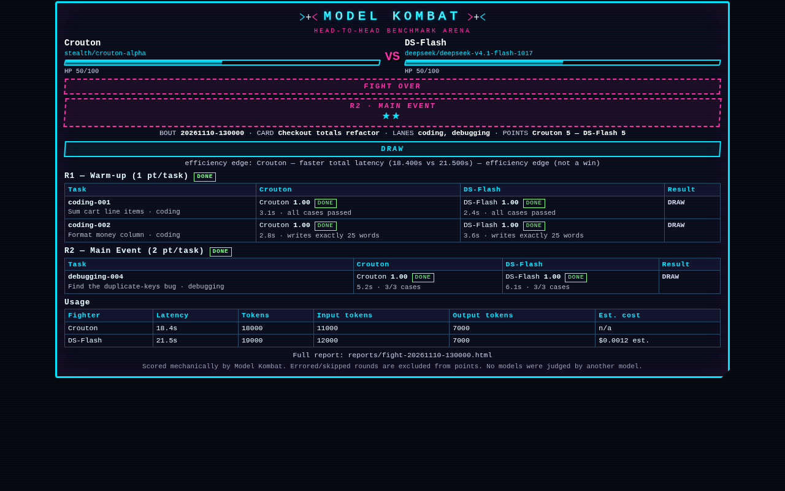
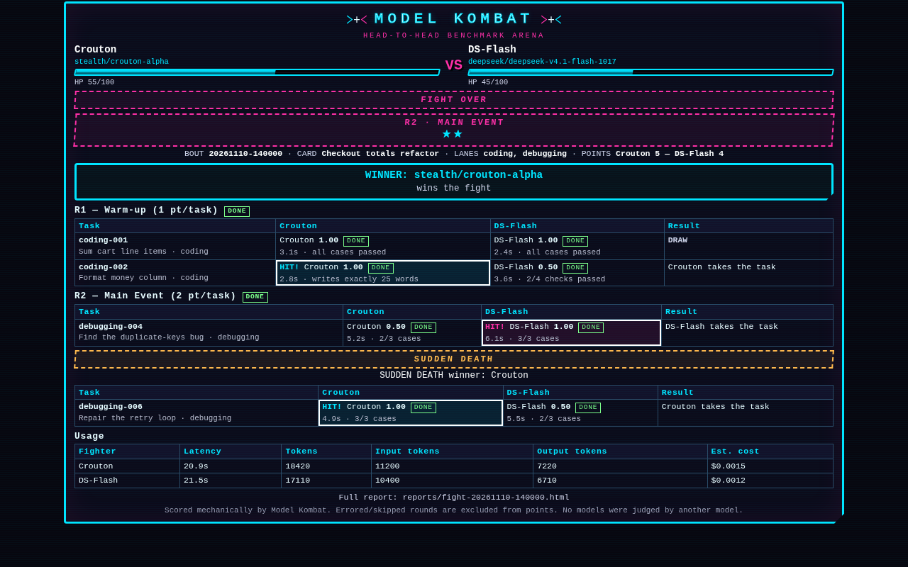
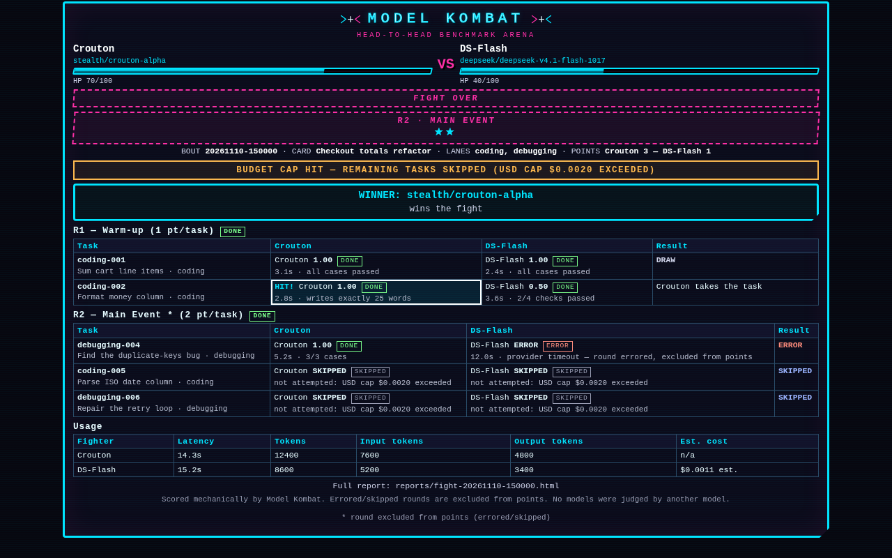
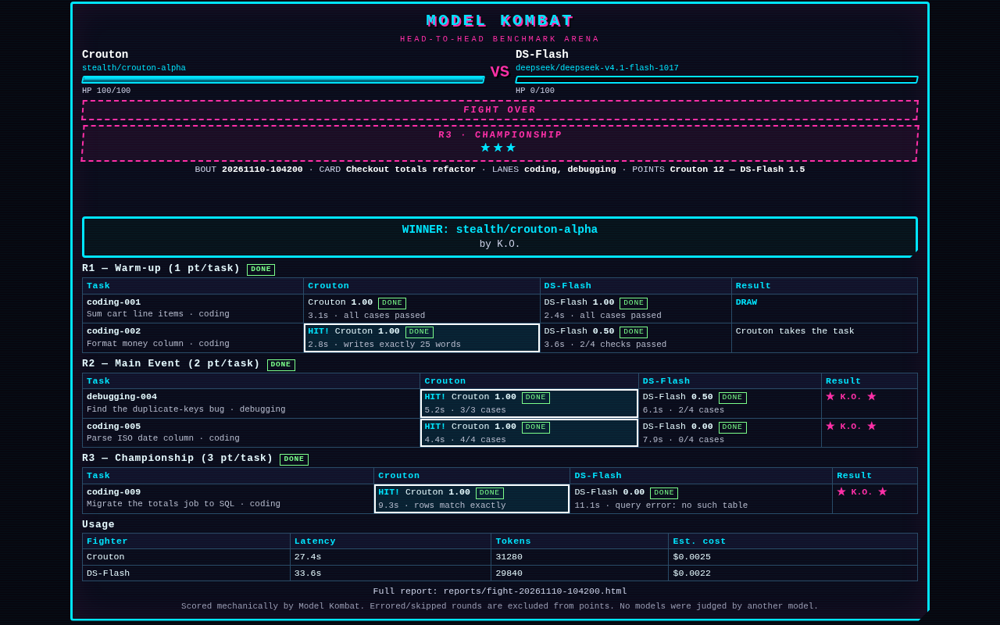
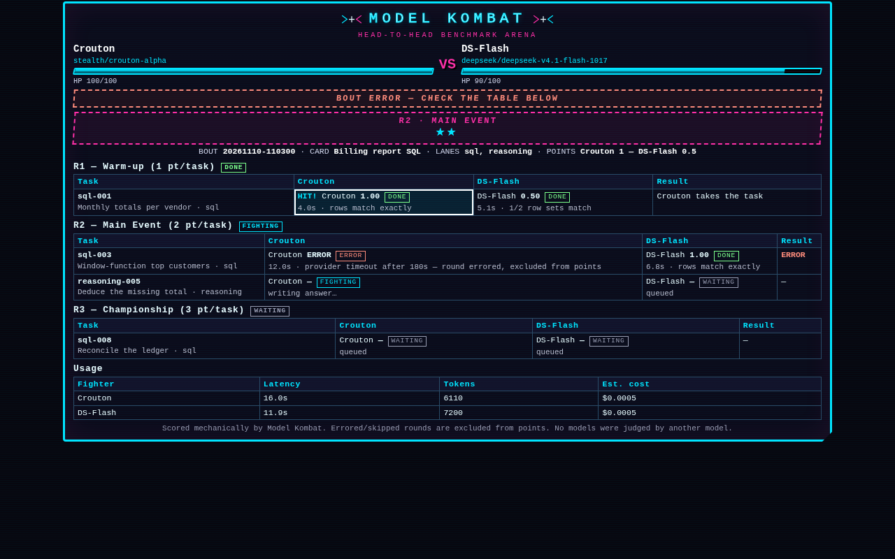
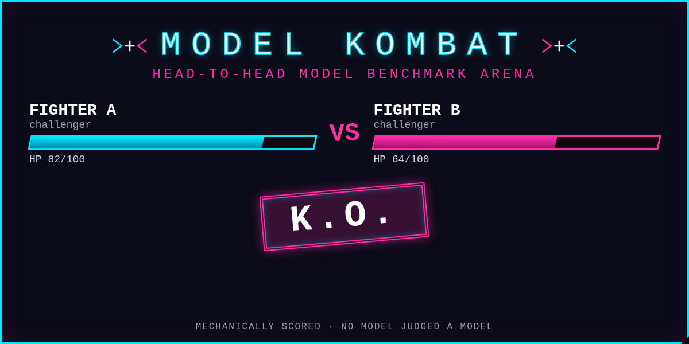

# Model Kombat

**Pit two Hermes models against each other on the same tasks and score the fight mechanically.**
Model Kombat is a Hermes plugin for head-to-head model evaluation. Point it at a task or a kanban card and it classifies the work into lanes locally (keyword rules, no LLM call), builds a deterministic fight card — Warm-up 1 pt, Main Event 2 pt, Championship 3 pt, plus sudden death — sends the identical prompts to two models through the host's LLM facade, then scores every answer mechanically: executed code, exact counts, numeric tolerances, synonym-aware phrase groups, JSON leaf equality, SQLite row comparison. No model judges another model. Results land in a per-lane Elo ladder, on a live arcade-style scoreboard in the Desktop pane, and as a recommendation badge on the kanban card you started from. Cards get harder on demand, the task pool learns which tasks actually separate two models, and the verdict says "no clear edge" when a strong pair simply ties.

```bash
hermes plugins install model-kombat     # once listed in the catalog
```

## The 3-step PM workflow

1. **Scout the work.** `/kombat scout card:t_9f21c4` (or paste the task text, or `board` for every open card). Kombat reads the card, classifies it into lanes, and returns a fight card with rounds, stakes, task IDs and the reasons each lane was picked. Add `--hard` or `--gauntlet` to raise the difficulty mix. The same input always builds the same card.
2. **Fight.** Ask in chat: *"Fight `stealth/crouton-alpha` vs `deepseek/deepseek-v4.1-flash-1017` on that card."* The bundled skill calls `kombat_run_fight` with the scouted card (object or `card-…` id), both models answer every task in it, and the arcade pane plus the `model-kombat` kanban board update live while answers land. Pure fights run in the background, so the chat stays usable. `/kombat fight <A> vs <B>` with no `--card` runs the fixed legacy suite instead of a scouted card.
3. **Read the verdict.** `/kombat score` scores the fight and writes the HTML versus scorecard; `kombat_recommend` (or `/kombat recommend board`) writes the per-lane knockout pick into `recommendations.json`, which the Desktop paints as a badge on each kanban card — pick, lane, verdict, confidence, Elo.

## Lanes

Eight lanes; the scout picks the top three with non-zero weight and falls back to `reasoning` + `instruction` when nothing matches.

| Lane | Signals it matches |
|---|---|
| `coding` | implement, refactor, algorithm, function, tests, API |
| `debugging` | bug, traceback, stack trace, exception, broken |
| `extraction` | extract, parse, fields, entities, invoice, scrape, key-value |
| `summarization` | summarize, summary, tl;dr, condense, key points, shorten |
| `reasoning` | calculate, how much/many, estimate, trade-off, percentages, totals |
| `instruction` | exactly, constraints, must, do not, respond with, start/end with |
| `recall` | passage-based questions, according to the text, quote, who, when did |
| `sql` | SELECT, joins, GROUP BY, schema, rows |

A card is built from the top lane(s):

| Round | Stake | Tasks |
|---|---|---|
| R1 Warm-up | 1 pt | 2 tasks from the top lane(s) |
| R2 Main Event | 2 pts | 2–3 tasks spread over the top two lanes |
| R3 Championship | 3 pts | 1–2 tasks from the top lane |
| Sudden death | tie-break | 1 task from the top lane, fought up front, only used on a tie |

Project tasks in `<cwd>/.kombat/tasks.json` (same schema) are mixed into the lane's Main Event.

## Intensity levels

`standard`, `hard` and `gauntlet` set the difficulty mix of the card. The default comes from the `default_intensity` setting; the slash command and the tool both take an explicit override.

| Intensity | R1 Warm-up (1 pt) | R2 Main Event (2 pts) | R3 Championship (3 pts) | Sudden death |
|---|---|---|---|---|
| `standard` | 2 × difficulty 1 | 2–3 × difficulty 2 | 1–2 × difficulty 3 | difficulty 3, else 2 |
| `hard` | 2 × difficulty 2 (no difficulty 1 anywhere) | 2–3 × difficulty 3 | 2 × difficulty 3 | difficulty 3 |
| `gauntlet` | 2 × difficulty 3 | 3 × difficulty 3 | 3 × difficulty 3 | difficulty 3 |

```bash
/kombat scout card:t_9f21c4 --hard        # skip the easy warm-ups
/kombat scout card:t_9f21c4 --gauntlet    # every task is difficulty 3
/kombat fight stealth/crouton-alpha vs deepseek/deepseek-v4.1-flash-1017 --card card-15b9f4edc0 --gauntlet
```

Intensity is part of the card id, so a gauntlet card and a standard card are different cards and are never confused in `cards.json`. On a fresh pool with too few difficulty-3 tasks, the builder fills short rounds from neighbouring difficulties rather than shipping an empty round — so `gauntlet` degrades to "as hard as the pool allows", not to a broken card.

## Task discrimination memory

Every scored fight is folded into `task_stats.json` in the plugin data dir. Per task it records `fights`, `split` (how often the two scores differed), `both_perfect`, `both_zero`, `mean_gap` (mean absolute score gap) and a `per_model` mean. The write is atomic and idempotent per `fight_id`; the applied-id list is capped at 500 fights.

The card builder uses that memory when it picks tasks inside a difficulty bucket:

1. **Never fought** tasks first (there is nothing to learn from yet).
2. **Discriminating** tasks next — most splits, then widest mean gap.
3. **Least saturated** tasks after that — lowest both-perfect ratio.
4. **Demoted last:** a task fought three or more times where both models scored 1.0 every time. It has stopped telling you anything.

The seed still breaks ties inside the winning tier, so a card is deterministic for a given stats snapshot. The scout reports `expected_discrimination` (`low` / `medium` / `high` / `unknown`) — the share of the card's tasks that split in prior fights (≥ 50 % is high, ≥ 25 % medium). On a fresh install there are no stats, every task is "never fought", and cards match the seeded historic behaviour.

Deleting `task_stats.json` resets the memory; nothing else depends on it.

## Tools

All nine are registered under the `model_kombat` toolset.

| Tool | What it does |
|---|---|
| `kombat_list_tasks` | Lists the fixed legacy suite (three rounds + sudden death) with each task's scorer type. |
| `kombat_scout` | Classifies free text, `{"card": "<kanban id>"}` or `{"board": true}` into lanes and builds a deterministic card (`intensity`: `standard`/`hard`/`gauntlet`); stores it in `cards.json`. |
| `kombat_run_fight` | Pure fight: both models answer every card task through the host LLM facade, with 429-aware waiting, a USD cap and a token cap; drives live state and the board. |
| `kombat_run_agentic_fight` | Same tasks run as real kanban worker sessions with a per-task model override; slower, needs a gateway dispatcher, billed per worker. |
| `kombat_score_answers` | Scores answer sets mechanically, writes the HTML versus scorecard, appends to history, updates the ladder and `task_stats.json`. |
| `kombat_rematch_errors` | Re-runs only the (task, fighter) pairs that errored and merges the new answers into the stored fight. |
| `kombat_recommend` | Per-lane knockout pick from the ladder (pick, margin, verdict, confidence, cost per point, runner-up, why); `board: true` writes card badges. |
| `kombat_history` | Lists recent scored fights (winner, points, report path). |
| `kombat_export` | Exports one past fight as JSON, Markdown or CSV under the plugin data dir. |

## Slash commands

| Command | Action |
|---|---|
| `/kombat` or `/kombat help` | The command list and current fight setup. |
| `/kombat tasks` | Lists the legacy fixed suite. |
| `/kombat scout <text>` | Classify text, build a card. |
| `/kombat scout card:<id>` | Scout one kanban card. |
| `/kombat scout board` | Scout every open card on the active board. |
| `/kombat scout … --hard` / `--gauntlet` | Build the card at the higher intensity mix. |
| `/kombat fight <A> vs <B>` | Pure fight, in the background. Add `--card <id>`, `--lanes a,b`, `--seed N`, `--hard` or `--gauntlet`. |
| `/kombat agentic <A> vs <B>` | Agentic worker fight in the background. |
| `/kombat status` | Whether the background fight is running, and the result/error when it finished. |
| `/kombat score` | Scores the last fight in this session and prints the scorecard path. |
| `/kombat rematch` | Re-fights the last fight's errored tasks. |
| `/kombat history` | Ten most recent fights. |
| `/kombat export [json\|md\|csv]` | Exports the latest fight (with several in history, call `kombat_export` with `index`). |
| `/kombat recommend [lane\|board]` | Knockout pick for a lane, or badges for every open card. |
| `/kombat ladder` | The raw per-lane Elo ladder. |

You can also just ask: *"Scout this kanban card and fight these two models on it"* — the bundled `model-kombat` skill drives the tools.

## The Desktop pane

The pane docks on the right; there is also a full page at `/kombat`, a sidebar entry, a status-bar chip and the palette command **Open Model Kombat**. It subscribes to `plugin.model-kombat.fight.updated` events and falls back to REST polling of the plugin's read-only dashboard API.

| Screen | What it shows |
|---|---|
|  | **Wide layout** — HP bars, round banner, task table, usage table. |
|  | **Mid-fight** — hit flashes per task, HP dropping as points are won. |
|  | **Draw** — `DRAW` banner, equal points, plus the explicitly non-winning efficiency line (faster latency, fewer output tokens or lower cost). |
|  | **Sudden death** — the tie-break task decides the fight; it adds no points of its own. |
|  | **Budget cap** — remaining tasks skipped, with the cap that stopped the fight named on screen. |
|  | **Finished** — K.O. stamp, winner card, final points. |
|  | **Degraded** — a rate-limited task shown as an error, excluded from points, never counted as a loss. |



These images use repository-relative paths for local previews. The catalog entry pins every image to the submitted commit, e.g. `https://raw.githubusercontent.com/DarkeTech/model-kombat/<40-char-sha>/docs/previews/arena_ko.png`, so the published listing can never drift from the code.

## How scoring works

Every task carries a mechanical check spec. Each returns `score` (a fraction 0–1), `status` (`scored` | `skipped` | `errored`) and a human `detail` string.

| Check type | What it measures | Score |
|---|---|---|
| `exact` | Whole answer (or its last non-empty line) equals the expected string after trim/case/space normalisation. | 1.0 or 0.0 |
| `numeric` | Each expected number appears in the answer within tolerance. | fraction found |
| `phrases` | Each group of acceptable alternatives is present (case/space-insensitive), so "no one was injured" counts for "no injuries". | fraction of groups hit |
| `regex` | A pattern matches. | 1.0 or 0.0 |
| `constraints` | Word/sentence counts, starts-with, ends-with, banned and required tokens — one sub-check each. | fraction passed |
| `json_fields` | Expected leaf fields inside the first JSON object in the answer, numbers within tolerance. | fraction matched |
| `code_exec` | The answer's fenced Python block runs against `args`/`expect`/`raises` cases in the hardened runner. | fraction of cases passed; `skipped` when execution is off |
| `sql_exec` | The answer's fenced SQL (SELECT/WITH only) runs against an in-memory SQLite database and its rows are compared. | rows match or not |

**Errored is not failed.** A task with an errored answer side (typically a 429) or a `skipped` check (code execution off) is **excluded** from the round: it awards no points to either side and is never scored as a loss. A round where nothing could be scored is marked with an asterisk in the scorecard and contributes zero. Bad *answers* score 0.0; only bad *check specs* error.

**Round points.** In an adaptive card, the round's stake (1/2/3) goes to the fighter with the higher summed score fraction across that round's included tasks; an exact tie splits the stake. The fixed legacy suite awards each task its round's points instead.

**K.O.** Win every included Championship task outright while the opponent scores below 1.0 on at least one of them, and the fight ends by K.O. regardless of the earlier points.

**Sudden death.** The sudden-death task is fought **up front** — one extra task per fighter right after the rounds — so a tie after the Championship can be decided without a second run. Its answers are stored but ignored unless the points are exactly tied. Only then are they scored: the task decides the winner and adds no points of its own. If it also ties (or could not be scored), the fight is a **draw**. If the USD or token cap was hit before the sudden-death call, there are no sudden-death answers and a tie stays a draw.

**Ladder.** Each scored lane bout updates `ladder.json`: Elo per model per lane, K=24, starting at 1500, plus wins/losses/draws, fights, points, cost and latency. A recommendation's **confidence** comes from the pick's fight count — fewer than 3 fights is `low`, 3–7 `medium`, 8 or more `high` — and drops one level when the Elo margin over the runner-up is under 15. **Cost per point** is the model's recorded spend in that lane divided by the points it won there, so a cheap model that wins narrowly can outrank an expensive one. It shows `n/a` when the model has no known price.

## Reading a draw honestly

Strong models on short, mechanical tasks tie a lot. Kombat says so instead of manufacturing a winner:

- **`DRAW` is a real result.** Equal points after the Championship and an unresolved sudden death means neither model won. The ladder records it as a draw; no Elo is invented.
- **The ≈ badge.** When the top-two Elo margin is under 15 — over a lane, or over the weighted average of a card's lanes — the pick is labelled `verdict: "no clear edge"`, its short name gets a `≈` prefix, confidence is forced to `low`, and the `why` line calls it an efficiency tiebreak (latency/cost), not a performance win. `≈Crouton` on a card means "roughly a coin flip", not "winner".
- **Efficiency edge ≠ win.** A draw can still name who was cheaper or faster (lowest total latency, then fewer output tokens, then lower cost). The scorecard and the arena print `efficiency edge (not a win)`; it never changes `winner`, never touches the ladder and never flips a badge to a pick. The edge object also carries the measured ratios when both call costs are known — `latency_ratio`, `cost_ratio`, `value_summary` (`Nemo-Nano is 2.8× faster and 18.0× cheaper at equal score`) — and the report prints that clause after the reason.
- **Best value on a tie.** When the margin is under 15 Elo and both models have measured cost and latency, `kombat_recommend` adds a `value_edge` block and appends one clause to `why`: `Measured: equal quality — Nano is 18.0× cheaper and 2.8× faster.` The ratios are computed from the ladder's own `cost_per_point` and `latency_per_task` (per lane, weighted across the card's lanes); under 5% counts as noise and no clause is printed. Unknown prices keep it `n/a` — never a fabricated comparison. It is a purchasing answer at equal quality, still labelled *not a performance win*.
- **The overall pick agrees with the lane picks.** The overall pick is the weighted average lane Elo, restricted to models that have Elo in **every** lane of the card (a model that only fought one lane can't win the card). Ties break by lane picks won, then coverage, then measured cost/latency — never alphabetically, which is what used to make the overall pick disagree with a unanimous per-lane pick.
- **Ties are the honest answer.** If you need a decision, fight a harder card (`--gauntlet`), add ties to `task_stats.json` via more fights, or accept that at this task mix the two models are equivalent — which is itself a useful purchasing answer.

## Cost estimation

The host's LLM facade reports token counts but no price, so the plugin prices every call locally.

- **`prices.json`** ships with the plugin: a map of model ID → `{"in": USD per 1M input tokens, "out": USD per 1M output tokens}`. It is local data used to **estimate** cost; it is not a billing feed and can lag a provider's real prices.
- **`model_prices`** (Settings) is merged over the shipped table key by key, so you can add a model or correct a price without editing the package.
- **`cost_source`** is recorded per call and per fighter:
  - `host` — the host supplied a cost (used as-is);
  - `estimated` — computed from `prices.json` / `model_prices`;
  - `unknown` — no price for that model. Cost is `null` and every surface prints **`n/a`**, never `$0.00`, so an unpriced model cannot look free.
- **`cost_per_point`** is likewise `n/a` when the cost or the points are unknown.

To price a new model, add it under Settings → Plugins → Model Kombat → *Model prices*, or edit `prices.json` in your checkout.

## Budget caps

Two independent caps stop a pure fight; whichever trips first ends it, and the arena names the cap that fired (`BUDGET CAP HIT — remaining tasks skipped`).

| Cap | Default | Stops when |
|---|---|---|
| `max_fight_cost_usd` | `2.0` | Cumulative **estimated** cost across both fighters exceeds the cap. With unpriced models this cap cannot fire. |
| `max_fight_tokens` | `400000` | Combined input + output tokens across both fighters exceed the cap — works even when every price is unknown. |

The caps are checked after every model call, so a fight can overshoot by at most one call. Both can also be set per call (`budget_usd`, `budget_tokens`). Agentic worker sessions are billed separately and are **not** capped by either setting.

## Rate-limit-proof runner

A 429 is treated as data, not a crash:

- **`pace_ms`** (default `0`) pauses before every model call — 500–1500 ms is a sane value for tight providers.
- **`max_rate_wait_s`** (default `120`) is the longest single 429 wait. The provider's `retry_after` is honoured up to that ceiling, with jittered backoff and up to three attempts per call.
- **Per-fight wait budget** `rate_wait_budget_s` (default `240`, per-call argument) bounds the total time spent waiting in one fight.
- **`auto_rematch`** (default `true`) retries errored (task, fighter) pairs up to two extra passes **inside the same fight**; `max_rematch_passes` (0–2) overrides the count per call.
- **Exhausted pairs stay `errored`** — excluded from the round, never counted as a loss. `/kombat rematch` retries them later once the limit clears.

## Install

```bash
hermes plugins install model-kombat          # from the catalog, once listed
```

From a checkout:

```bash
git clone https://github.com/DarkeTech/model-kombat ~/src/model-kombat
ln -s ~/src/model-kombat ~/.hermes/plugins/model-kombat
hermes plugins enable model-kombat
```

Restart the session (or the Desktop app) after enabling: the tool list is built at session start.

### One-time setup: allow the model override

Fights call the host's LLM facade with an explicit model, which is gated by design — the plugin never sees your credentials. Grant it once in `~/.hermes/config.yaml`:

```yaml
plugins:
  entries:
    model-kombat:
      llm:
        allow_model_override: true
        # recommended: bound spend to the models you actually want to compare
        allowed_models:
          - stealth/crouton-alpha
          - deepseek/deepseek-v4.1-flash-1017
      granted_capabilities: ["llm.model_override"]
```

`allowed_models` is optional but recommended: without it, any model ID you type is accepted. With it, a fight can only use the listed IDs. Scoring pasted answer sets with `kombat_score_answers` needs no LLM access at all. Check what the host thinks is granted with `hermes plugins capabilities model-kombat` (declared vs granted).

## Settings

Settings → Plugins → Model Kombat (all keys from `plugin.yaml`):

| Setting | Default | Meaning |
|---|---|---|
| `fighter_a` | `stealth/crouton-alpha` | Default first model ID. |
| `fighter_b` | `deepseek/deepseek-v4.1-flash-1017` | Default second model ID. |
| `temperature` | `0` | Applied to both fighters; 0 keeps the comparison fair. |
| `default_intensity` | `standard` | Difficulty mix when a scout/fight does not pass `intensity`: `standard`, `hard` or `gauntlet`. |
| `max_tokens` | `2000` | Max tokens per answer. |
| `max_fight_cost_usd` | `2.0` | Pure fights stop once estimated cumulative cost passes this. Agentic worker billing is separate and not capped. |
| `max_fight_tokens` | `400000` | Pure fights stop once combined input+output tokens across both fighters pass this; works when prices are unknown. |
| `model_prices` | `{}` | Map of model ID → `{"in": USD/1M input, "out": USD/1M output}`, merged over `prices.json`; unknown models cost `n/a`, never 0. |
| `llm_timeout_s` | `180` | Per-call timeout. |
| `pace_ms` | `0` | Pause before each model call, to stay under provider rate limits. |
| `max_rate_wait_s` | `120` | Longest single 429 wait before the pair is reported errored. |
| `auto_rematch` | `true` | Retry errored (task, fighter) pairs up to two extra passes inside the same fight. |
| `agentic_timeout_s` | `600` | Max runtime per agentic worker task. |
| `allow_code_execution` | `false` | Execute model-written code for code tasks. Off means those tasks are skipped and excluded from points. Not a sandbox — see Disclosure. |
| `show_on_kanban` | `true` | Mirror the fight onto the dedicated `model-kombat` board (unassigned display cards). |

The run tool also accepts `rate_wait_budget_s` (total 429 wait per fight, default 240), `max_rematch_passes` (0–2), `budget_usd` and `budget_tokens` per call.

## Differentiation

Closest existing catalog entries, and what each one actually does:

| Entry | What it does | How Model Kombat differs |
|---|---|---|
| `model-drift-watch` | Scheduled check that the model you use has not quietly got worse; 34 fixed questions, per-question exact grading, cron. | Kombat builds an adaptive card per task and fights two models head-to-head; drift-watch watches one model over time on a fixed set. |
| `model-leaderboard` | A `/model-leaderboard` page ranking OpenRouter models on context, price and public benchmarks. | Kombat evaluates two specific models on *your* tasks; the leaderboard ranks the whole OpenRouter catalogue on public numbers. |
| `evalroute` | Classifies a task into a lane and routes it to a (model, reasoning effort) arm before starting. | Kombat uses the lane to build a scored contest between two fixed fighters, not to route one job. |
| `arena-skill` | Tournament of N sub-agents competing to produce the best answer. | Kombat is exactly two models, scored mechanically per task, not N agents judged by an agent. |
| `hermes-model-switcher` | Dashboard tab for per-profile model selection across Hermes's model slots, with apply/revert. | Kombat measures models against each other with mechanical scoring and board badges; the switcher changes which model a profile uses. |
| `openrouter-picker` | Desktop model picker plus composer provider. | Kombat never selects a model for you: it produces evidence (points, Elo, cost per point) for a pairing you chose. |

At submission time, no other listed entry shipped an arcade-versus pane or per-card kanban recommendation badges.

## Disclosure

Read this before installing.

- **Network.** No third-party service calls. Fights go through the host's LLM facade (`ctx.llm.complete`) to whichever provider your profile already uses, under Hermes's own routing and credentials. The dashboard API is local and read-only; the Desktop pane talks to it through the host.
- **LLM spend.** A pure fight bills two model calls per task, plus one sudden-death call per fighter, to your account. Usage (latency, tokens, estimated cost) is recorded per call, and the fight stops when estimated cumulative cost passes `max_fight_cost_usd` (default $2.00) or combined tokens pass `max_fight_tokens` (default 400,000). Costs are local estimates from `prices.json` / `model_prices`; unknown models show `n/a`. Agentic fights dispatch real worker sessions, billed separately and **not** covered by those caps.
- **Subprocess and code execution.** `code_exec` tasks are **off by default**; when off they are `skipped` and excluded from points. When enabled, model-written Python runs in a separate `python -I` subprocess with cwd in a fresh tempdir, an empty environment, resource limits (CPU, address space, core files, processes, file size), a wall timeout (12 s cap), capped output, a Python audit hook and an import blocker. At the Python level it refuses writes and renames outside the tempdir, process spawning, network audit events (`socket.*`) and imports of `ctypes`, `socket`, `subprocess`, `multiprocessing`, `pty`, `urllib` and similar modules.
  **It is defense-in-depth, not a sandbox.** It does not stop direct syscalls, code paths in already-loaded C extensions, `ctypes` reached through a preloaded shared object, or anything else that never emits a Python audit event; reads outside the tempdir are restricted only on the same best-effort basis. The code runs as your user. Enable it only for models you are willing to trust with that.
- **Kanban writes.** With `show_on_kanban` on (default), the plugin creates a dedicated `model-kombat` board, a parent scoreboard card and one card per task through the host's `terminal` tool, i.e. through Hermes's normal command approval. Cards are **unassigned display cards** and are never dispatched to a worker. Board updates are best-effort: a failure never fails the fight.
- **File writes.** Reports, `live.json`, `ladder.json`, `recommendations.json`, `cards.json`, `task_stats.json`, `fights.jsonl` and exports are written under the plugin data dir (`$HERMES_HOME/plugin-data/model-kombat/`, else `~/.hermes/plugin-data/model-kombat/`). Nothing else on disk is written.
- **Desktop plugin and dashboard API.** `desktop/plugin.js` runs in the Desktop renderer using only the plugin SDK (pane, route, sidebar, status chip, palette command, kanban badges); it registers no DOM patches and loads no remote code. `dashboard/plugin_api.py` exposes read-only `GET /live`, `/ladder`, `/history`, `/recommendations`, `/health`, mounted under `/api/plugins/model-kombat/`.
- **Telemetry.** None. No analytics, no phone-home, no update check.
- **Credentials.** Never read. No `.env`, `auth.json`, keychain or vendor token files; the plugin has no `requires_env` and only ever asks the host to make a call. Its only declared capability is `llm.model_override`.

## Troubleshooting

| Symptom | Cause and fix |
|---|---|
| *"Host refused the model override"* | The `llm.allow_model_override` block above is missing or the model isn't in `allowed_models`. Fix config, retry. Nothing was sent. |
| Tools missing after enabling | The tool list is built at session start. Start a new session (Desktop: reload the window). |
| Edited the source, behaviour is stale | The plugin host caches loaded code. `hermes plugins disable model-kombat && hermes plugins enable model-kombat`, then start a fresh session. No gateway restart needed. |
| Fights stalling on 429s, or tasks arriving `errored` | Rate limits are waited out with jittered backoff: up to three attempts per call, up to `max_rate_wait_s` per wait, within a 240 s per-fight wait budget, then up to two auto-rematch passes. Set `pace_ms` (e.g. 500–1500) and raise `max_rate_wait_s` for tight providers. Errored pairs are excluded, not failed — `/kombat rematch` after the limit clears. |
| Cost shows `n/a` | That model has no entry in `prices.json` or `model_prices`, so cost is unknown by design (never assumed `$0`). Add a price to enable the USD cap and cost-per-point. |
| Fight stopped early with `BUDGET CAP HIT` | Either `max_fight_cost_usd` or `max_fight_tokens` tripped. Raise the setting, narrow the card, or run a cheaper pairing. |
| A round shows an asterisk | Every task in it was excluded (errors or code execution off). Nothing was awarded to either side; re-run or enable execution. |
| `code_exec` tasks all skipped | `allow_code_execution` is false. That is the default; the tasks are excluded from points. |
| Agentic tasks stuck `ready` | The gateway dispatcher isn't running: `hermes gateway start`. Pure fights don't need it. |
| Board missing or empty | `show_on_kanban` is off, or the host `terminal` command failed (board updates are best-effort). Check `hermes kanban boards`. |
| Badge shows `≈Model` | Correct: the top-two Elo margin is under 15, so the verdict is "no clear edge". Fight a harder card or more bouts to separate the models. |
| Pane or `/kombat` page blank | The dashboard backend isn't serving; confirm the gateway is up and `GET /api/plugins/model-kombat/health` responds. The pane falls back to polling only if the event stream is unavailable, not if the API is down. |

## Develop / validate

```bash
python3 tests/test_scoring.py                 # scorer + mock-host tests (no Hermes needed)
for t in tests/test_*.py; do python3 "$t" || break; done   # full suite, plain scripts
hermes plugins doctor . --ci               # registration check
hermes plugins validate . --install-deps   # catalog check — must pass before a PR
python3 scripts/render_previews.py         # regenerate docs/previews/*.png (needs chromium)
python3 scripts/make_banner.py             # regenerate docs/banner.png (1200x600)
```

## Layout

```
plugin.yaml            manifest (capabilities: llm.model_override, 9 tools, config schema)
__init__.py            register(): tools, /kombat command, bundled skill
schemas.py             tool schemas (what the model sees)
tools.py               pure fight runner, scoring, history, report, kanban hookup, pricing
engine_checks.py       mechanical check-spec scorers + hardened code/SQL runner
lanes.py               lane classifier, task pool, intensity mix, task_stats preference, card builder
ladder.py              per-lane Elo, recommendations, cost per point
live.py                live.json state machine + event broadcast
kanban.py              board scoreboard, agentic worker fights
render.py              standalone HTML scorecards and arena previews
prices.json            shipped USD-per-1M-token price table (local estimate data)
dashboard/             read-only FastAPI plugin API (plugin_api.py)
desktop/               Desktop pane/route/badges (plugin.js)
tasks/ , tasks.json    lane task pools + legacy fixed suite
docs/ARCHITECTURE.md   module and data-flow map
```

## Roadmap

- Judge-assisted rounds for open-ended tasks, clearly labelled non-deterministic and never mixed into mechanical points.
- Richer lane coverage (vision, long-context) and per-lane task packs beyond the eight current lanes.
- Ladder trends over time (Elo history per model, not just the latest rating).

## License

MIT — see `LICENSE`. All names, art, CSS and audio cues are original.

Not affiliated with any game franchise; original art and wording.
